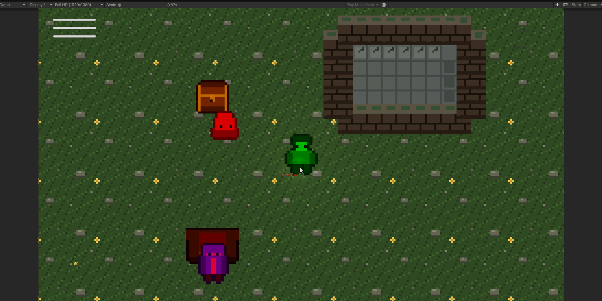

# Relic & Coin — 2D Top-Down Action RPG & Shop Management


*(Ghi chú: Bạn có thể thay đường dẫn ảnh GIF thực tế sau khi quay màn hình)*

**Relic & Coin** là dự án game nhập vai hành động 2D kết hợp quản lý cửa hàng (lấy cảm hứng từ *Moonlighter*), được phát triển bằng **Unity 6 (URP 2D)** và **C#**. Dự án tập trung vào việc xây dựng một kiến trúc mã nguồn sạch (Clean Architecture), tách biệt hoàn toàn tầng logic nghiệp vụ khỏi Unity Engine để dễ dàng bảo trì, mở rộng và kiểm thử.

---

## Kiến trúc Kỹ thuật & Design Patterns

Thay vì viết toàn bộ logic vào các `MonoBehaviour` cồng kềnh, hệ thống của **Relic & Coin** được thiết kế dựa trên các nguyên tắc kỹ thuật sau:

* **Tách biệt Logic & Giao diện (Pure C# Core vs. Thin MonoBehaviour Views):** Toàn bộ lõi tính toán (chỉ số nhân vật, túi đồ lưới, kinh tế động, bảng rơi đồ, thuật toán tìm đường) được viết thuần C# (`Pure C#`), tách biệt khỏi vòng đời `UnityEngine` để có thể viết Unit Test độc lập.
* **Kiến trúc Hướng sự kiện (Event-Driven Architecture):** Sử dụng `ScriptableObject Event Channels` (`FloatEventChannel`, `IntEventChannel`, `DayPhaseEventChannel`...) làm cầu nối giao tiếp giữa các hệ thống (HUD, Ánh sáng 2D, Âm thanh, Chỉ số), loại bỏ sự phụ thuộc chéo (Decoupling).
* **Finite State Machine (FSM) tối ưu bộ nhớ (Zero GC Allocation):** Áp dụng mẫu thiết kế State Machine cho cả người chơi (`PlayerController` với 7 trạng thái) và kẻ địch (`EnemyController`). Toàn bộ các thực thể trạng thái (`IState`) được khởi tạo một lần duy nhất trong `Awake()` và tái sử dụng, tránh phát sinh rác bộ nhớ trong vòng lặp khung hình.
* **Thuật toán Tìm đường & Sinh bản đồ ngẫu nhiên:**
  * **Procedural Dungeon Generation:** Sinh sơ đồ các phòng liên thông (`Start`, `Combat`, `Treasure`, `Shop`, `Boss`) dựa trên hạt giống (`Seed`) ngẫu nhiên.
  * **A* Pathfinding tối ưu bộ đệm:** Tái sử dụng mảng `OpenSet` / `ClosedSet` và truy vấn vật lý bằng API `Physics2D.OverlapCircle` không cấp phát rác.
* **Hệ thống Vòng lặp Ngày/Đêm & Kinh tế Động:**
  * Tự động điều phối 4 pha thời gian (`Morning_Prep`, `Day_ShopOpen`, `Evening_Closing`, `Night_Dungeon`) đồng bộ với hệ thống chiếu sáng **URP 2D Lighting** (`Global Light 2D` + đèn lồng nhân vật).
  * **Grid Inventory & Dynamic Economy:** Túi đồ dạng lưới 5x4 hỗ trợ lời nguyền vật phẩm (`DestroyAdjacent`, `SendHome`, `EdgeOnly`), hệ thống định giá tự do theo cung-cầu và AI khách hàng phản ứng 4 mức cảm xúc giá.
  * **Hệ thống Độ khó & Rơi đồ phân tầng:** 3 chế độ (`Normal`, `Hard`, `Nightmare`) điều chỉnh ngưỡng trí thông minh AI (tầm phát hiện, nhịp ra đòn, phản xạ né đòn/trừng phạt) và dải trang bị/tỷ lệ rơi vật phẩm 5 bậc (`Normal` -> `Mythical`).

---

## Cấu trúc Thư mục Dự án (`Assets/_Project/Scripts/`)

```text
Assets/_Project/Scripts/
├── AI/
│   ├── Boss/           # Logic Boss đa giai đoạn (Multi-phase Boss)
│   ├── Enemies/        # AI Quái vật thường, FSM States & Context
│   └── Shop/           # AI Khách hàng mua sắm, phản xạ sợ hãi & Nhân viên trả lương
├── Combat/
│   ├── Loot/           # Hệ thống trang bị quái & tỷ lệ rơi đồ phân tầng theo độ khó
│   ├── Runes/          # Hệ thống khảm ngọc 5 bậc (Normal -> Mythical)
│   ├── StatusEffects/  # Hiệu ứng bất lợi (Burn, Freeze, Poison, Stun, Bleed)
│   └── Weapons/        # Dữ liệu 23 nhóm vũ khí, Hitbox & Bộ tính sát thương
├── Core/
│   ├── Audio/          # AudioManager sử dụng Object Pool cho SFX
│   ├── Difficulty/     # Cấu hình 3 mức độ khó (Normal, Hard, Nightmare)
│   ├── Events/         # ScriptableObject Event Channels
│   ├── Lighting/       # Điều khiển ánh sáng ngày/đêm URP 2D & Đèn lồng nhân vật
│   ├── SaveLoad/       # Lưu/Tải tiến trình người chơi định dạng JSON
│   ├── StateMachine/   # Bộ khung FSM dùng chung (IState, StateMachine)
│   ├── Stats/          # Hệ thống chỉ số HP, Stamina (khóa mệt mỏi Fatigue), Mana
│   └── Time/           # Bộ đếm chu kỳ Ngày/Đêm (DayCycleController)
├── Dungeon/
│   ├── Curse/          # Lời nguyền hầm ngục & Dịch vụ thanh tẩy
│   ├── Generation/     # Sinh phòng ngẫu nhiên & Vẽ bản đồ Tilemap
│   └── Pathfinding/    # Thuật toán tìm đường A* trên lưới 2D
├── Editor/             # Công cụ tự động sinh ScriptableObjects & Pixel Art Sprites
├── Inventory/          # Túi đồ lưới 2D (Grid Inventory) & Xử lý lời nguyền vật phẩm
├── Player/             # Điều khiển nhân vật, Class (Chiến binh/Phù thủy) & Cây kỹ năng
├── Shop/               # Kinh tế động, Sổ tay giá cả, Nâng cấp Base & Chế tạo
└── UI/                 # Tầng hiển thị giao diện mỏng (MainMenu, HUD, ShopCounter, PriceBook)
```

---

## Hướng dẫn Cài đặt & Chạy Dự án

### Cách 1: Chơi trực tiếp bản Build Windows (Không cần cài Unity)
1. Truy cập mục **[Releases](../../releases)** ở cột bên phải của kho lưu trữ này.
2. Tải về tệp nén **`RelicAndCoin-Windows-x64.zip`** ở phiên bản mới nhất.
3. Giải nén toàn bộ thư mục và chạy tệp **`RelicAndCoin.exe`**.

### Cách 2: Mở mã nguồn bằng Unity Editor
1. **Yêu cầu hệ thống:** Cài đặt **Unity Hub** và **Unity 6 (6000.x LTS)** kèm mô-đun **Universal Render Pipeline (URP)**.
2. **Clone dự án:**
   ```bash
   git clone https://github.com
   ```
3. Mở Unity Hub, chọn **Add -> Add project from disk** và trỏ tới thư mục vừa clone.
4. Trong cửa sổ **Project**, mở thư mục `Assets/_Project/Scenes/`, nhấp đúp mở **`MainMenu.unity`** và nhấn nút **Play (`▶`)**.

---

## Hướng dẫn Điều khiển & Trải nghiệm (Controls - v1.1.0)

| Phím bấm / Thao tác | Chức năng trong game |
| :--- | :--- |
| **`W` `A` `S` `D`** hoặc **Phím mũi tên** | Di chuyển nhân vật 4 hướng |
| **Giữ `Left Shift` + Di chuyển** | Chạy nhanh (`Sprint` — tiêu hao Stamina theo thời gian, cạn sẽ rơi vào trạng thái kiệt sức `Fatigue`) |
| **`Space`** | Lướt né nhanh (`Dash` — nhận khung bất tử `I-Frames` tức thì) |
| **`J`** hoặc **Chuột trái** | Tấn công bằng vũ khí trang bị (chém theo hướng nhìn hoặc con trỏ chuột, vệt chém trực quan 0.15s, đẩy lùi và gây sát thương thật lên quái vật) |
| **`E`** (hoặc **`F`**) | Tương tác môi trường: Mở rương kho báu (rơi 1–2 vật phẩm văng ra đất) & Nhặt đồ trên mặt đất (tự động trang bị nếu là vũ khí, hồi máu ngay nếu là bình thuốc, hoặc thêm vào túi đồ) |
| **Nhận sát thương từ Quái** | Slime tự động tuần tra và truy sát; khi vào tầm đánh sẽ gây sát thương trừ thẳng máu người chơi (`HP_Slider` tụt dần) kèm hiệu ứng nháy đỏ phản hồi |
| **Màn hình Game Over** | Tự động kích hoạt khi máu người chơi về `0 HP`, tạm dừng thời gian (`Time.timeScale = 0f`), hiển thị bảng phủ tối kèm 2 nút **"Chơi Lại"** (Reset Scene) và **"Về Menu Chính"** |

---

## Tác giả

* **Huỳnh Minh Khoa** — *Unity / C# Game Developer*
* GitHub: [@KhoaNguyen2k2](https://github.com)
